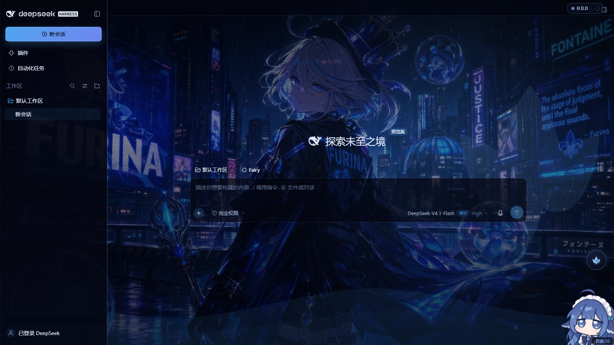
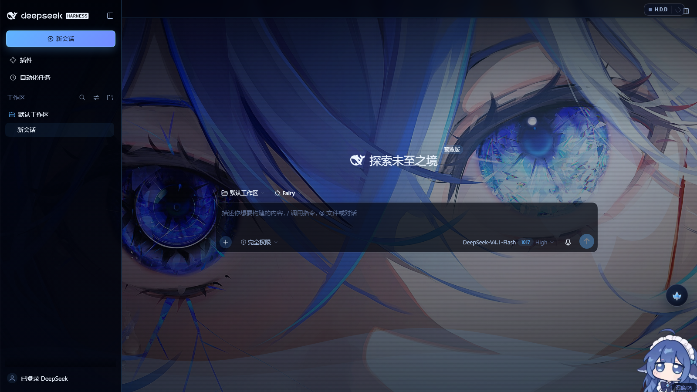
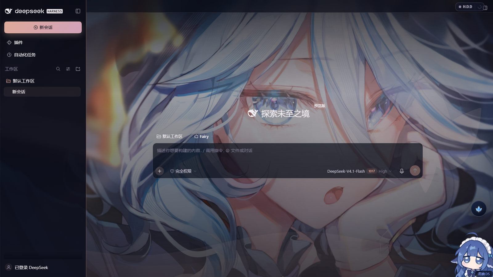
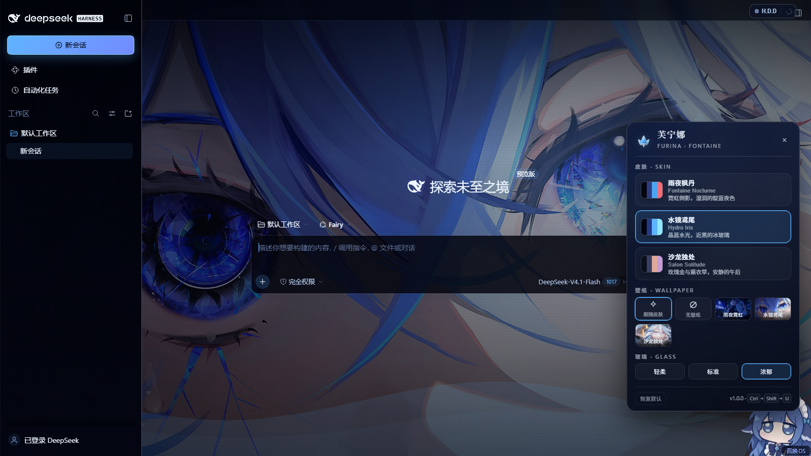
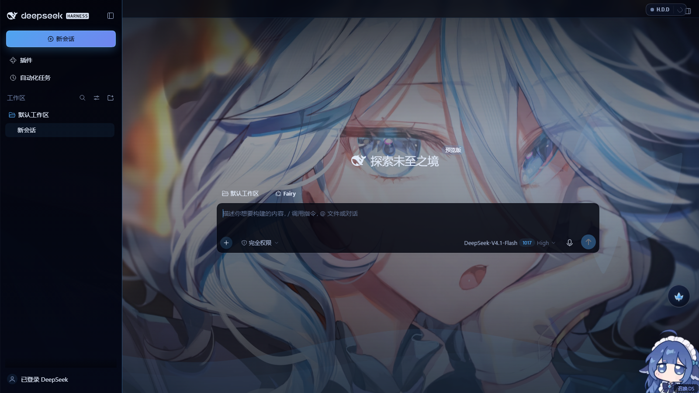

# furina-dsh-theme · 芙宁娜 / Fontaine theme for DeepSeek Harness

A complete web-theme plugin for the DeepSeek Harness Web GUI: three Furina / 芙宁娜
skins, a wallpaper layer you can switch on its own, translucent glass surfaces, and
an in-page switcher — no rebuild, no patched markup, no `!important` arms race.

Repository: **https://github.com/TanPass/furina-dsh-theme** ·
Install: `dsh plugin --profile web add github:TanPass/furina-dsh-theme` ·
Issues: https://github.com/TanPass/furina-dsh-theme/issues



| Skin | Preview |
| --- | --- |
| `fontaine-nocturne` 雨夜枫丹 |  |
| `hydro-iris` 水镜鸢尾 |  |
| `salon-solitude` 沙龙独处 |  |

| Switcher panel | Free wallpaper swap |
| --- | --- |
|  |  |

All five images are real captures of a live DSH instance (isolated `DSH_HOME`,
port 3081) driven by `tools/verify.mjs` — see [Verification](#verification).

---

## What you get

* **Three skins**, each a full palette (background, surfaces, text hierarchy, four
  accents, semantic colours) mapped onto DSH's own `--dsh-*` design tokens, so every
  stock component — sidebar, composer, message bubbles, code blocks, menus — re-skins
  without touching application markup.

  | id | 中文 | feel | accent |
  | --- | --- | --- | --- |
  | `fontaine-nocturne` | 雨夜枫丹 | rain-slick neon, indigo night | `#4ea4ef` |
  | `hydro-iris` | 水镜鸢尾 | crystal water, near-black ice glass | `#5fb4ff` |
  | `salon-solitude` | 沙龙独处 | rose-gold afternoon, lavender | `#dea998` |

* **A wallpaper layer** behind the whole application. Three shipped wallpapers plus
  `跟随皮肤` (auto — each skin's own art) and `无壁纸` (painted ground). Wallpaper and
  skin are independent: pick the night-city art with the rose-gold palette if you
  want. Any image you drop into `$DSH_HOME/furina-wallpapers/` shows up in the
  switcher as an extra tile — free wallpaper switching is not limited to the shipped
  set.
* **Translucent glass UI** in three strengths — `轻柔` / `标准` / `浓郁` — applied to
  the sidebar, composer, popovers and the switcher itself.
* **An in-page switcher** in its own Shadow DOM (so the app's styles cannot leak in):
  emblem launcher in the bottom-right corner (lifted above the pet widget, clear of the
  send button), `Ctrl + Shift + U` anywhere, `Esc` to close. Skin cards with live
  swatches, a wallpaper tile grid with thumbnails, glass modes, and a reset.
* **Persistence** in `localStorage` under `furina-theme.settings.v1`. Settings survive
  reloads; deleting the key (or the plugin) returns the GUI to stock.
* **No residue when disabled**: every rule is scoped to `html[data-furina-skin…]`, the
  backdrop and switcher are plain DOM nodes the plugin removes on dispose, and the app
  never sees a monkey-patched React tree.

## Requirements

* DSH with the Web GUI (`dsh web`), profile `web`.
* Node 22+ (only for the plugin process; the browser half is plain ES5-era JS).
* **No other full-page theme enabled.** Themes that repaint the entire shell — notably
  `dsh-theme-endfield` / `dsh-endfield-theme` — override the same `--dsh-*` tokens and
  paint their own opaque layer over the app. They are not broken, but they will win:
  enable one theme at a time. See [Coexistence](#coexistence-with-other-themes).

## Install

The plugin is a normal DSH cordis plugin, installed into a profile with `dsh plugin`:

```powershell
# canonical install — straight from GitHub
dsh plugin --profile web add https://github.com/TanPass/furina-dsh-theme
# same package, short GitHub spec
dsh plugin --profile web add github:TanPass/furina-dsh-theme

# or, without `dsh` on PATH, through the DSH checkout's CLI entrypoint
node "<dsh-checkout>\lib\bin.js" plugin --profile web add https://github.com/TanPass/furina-dsh-theme
```

A published version can be pinned the same way, e.g.
`dsh plugin --profile web add furina-dsh-theme@1.0.0`.

**Local development** — install the working tree as a link, so edits are live after a
page refresh:

```powershell
dsh plugin --profile web add file:"<path-to-this-checkout>"
```

The profile's `package.json` should then contain the artifact spec under
`dependencies`, with the package in `dsh.profile.bundles`:

```jsonc
{
  "dependencies": { "furina-dsh-theme": "github:TanPass/furina-dsh-theme" },
  "dsh": { "profile": { "bundles": [ /* …, */ "furina-dsh-theme" ] } }
}
```

Restart the DSH server once if the profile bundle list changed; after that, refresh
the page. `cordis.patch.yml` ships with the package and inserts its own `furina-theme`
plugin row; `dsh --dump-config` shows the resolved row (see Verification).

To uninstall: `dsh plugin --profile web remove furina-dsh-theme` (or remove the bundle
entry and the dependency), then restart the server. The browser half also disposes
cleanly if the plugin row is removed while a page is open.

## Coexistence with other themes

Two full-page themes cannot both own the surface. The measured behaviour with
`dsh-theme-endfield` + `dsh-endfield-theme` also installed:

* their rules win on `--dsh-*` tokens and paint an opaque page layer, so this theme's
  wallpaper and palette are mounted but invisible;
* nothing errors — the plugin simply renders underneath.

So enable exactly one theme. If the Furina theme does not appear:

1. Open the profile `package.json` (`C:\Users\<you>\.dsh\profiles\web\package.json`).
2. Remove `dsh-theme-endfield` and `dsh-endfield-theme` from `dsh.profile.bundles`.
3. Also remove the `- id: theme-endfield` row from `cordis.patch.yml` if present.
4. Restart the DSH web server and reload the page.

(Removing other themes touches a live profile — back it up first. In the isolated
instance used for verification, the same two bundles were removed and the theme
painted immediately; with them present the theme mounted but stayed hidden.)

## Using it

* **Launcher** — the Furina emblem button in the bottom-right corner, lifted just above
  the pet widget so it stays clear of both the pet and the composer's send button.
* **Keyboard** — `Ctrl + Shift + U` toggles the panel, `Esc` closes it.
* **Panel** — skin cards (with accent swatches and a one-line description), wallpaper
  tiles (`跟随皮肤` / `无壁纸` / three art tiles / your own), glass strength, reset.
* **Custom wallpapers** — drop `.jpg`, `.png`, `.webp` or `.avif` files into
  `%USERPROFILE%\.dsh\furina-wallpapers\` (or `$DSH_HOME/furina-wallpapers/`), then
  reload the page. The launcher asks the host for the list via
  `GET /furina-theme/wallpapers`.
* **Scripting** — the browser half exposes a small API for console use and tests:

  ```js
  window.__furinaTheme.skins        // ['fontaine-nocturne', 'hydro-iris', 'salon-solitude']
  window.__furinaTheme.wallpapers   // ['city-noir', 'hydro-iris', 'salon-solitude']  (built-ins)
  window.__furinaTheme.state        // { skin, wallpaper, glass }
  window.__furinaTheme.mounted      // { sheet, backdrop, switcher, skin }
  window.__furinaTheme.setSkin('hydro-iris')
  window.__furinaTheme.setWallpaper('salon-solitude')  // 'auto' | 'none' | id | 'user:<file>'
  window.__furinaTheme.setGlass('rich')                // 'soft' | 'standard' | 'rich'
  window.__furinaTheme.openPanel(true)
  window.__furinaTheme.reset()      // defaults: fontaine-nocturne / auto / standard
  window.__furinaTheme.remount()    // re-inject after an SPA hard reset
  ```

## How it works

Two halves, one package.

**Host half — `lib/index.js`** (Node, runs inside the DSH server):

* registers one prefix route `/furina-theme` and serves the browser half:
  `theme.css`, `theme.js`, `assets/emblem.svg`, `assets/wallpapers/*.jpg`,
  `assets/thumbs/*.jpg`;
* path traversal is resolved and rejected (`resolveRelative`), requests are restricted
  to same-origin via `Sec-Fetch-Site` / `Origin`, and unknown files 404 instead of
  taking the route down;
* `GET /furina-theme/wallpapers` lists `$DSH_HOME/furina-wallpapers` (images only)
  and `GET /furina-theme/user-wallpaper/<name>` serves them;
* injects two tiny rows into `index.html`: a critical `html,body{background-color:…}`
  style (prevents a stock-white flash before the theme CSS loads) and the theme
  `<script>` tag; a companion row sets `data-furina-boot` on `<html>` so the first
  stylesheet can fade its decoration in. `theme.js` clears that attribute once the
  backdrop is mounted, with a 4-second timer as the fallback.

**Browser half — `client/theme.js` + `client/theme.css`** (no framework, no build):

* `theme.css` defines a semantic `--fr-*` palette per skin and maps it onto the app's
  `--dsh-*` tokens plus targeted surface rules scoped to `html[data-furina-skin…]`;
* `theme.js` owns the wallpapers (a fixed backdrop layer at `z-index:-1` so nothing
  intercepts input), the glass strength, the Shadow-DOM switcher, keyboard shortcuts
  and `localStorage` persistence;
* a `MutationObserver` reconciles the three injected nodes if the SPA (re)renders and
  drops them;
* the boot attribute `data-furina-boot` is removed on first paint so a failed load
  never leaves the page with a blank ground.

Settings shape (versioned, tolerant of unknown values):

```json
{ "skin": "fontaine-nocturne", "wallpaper": "auto", "glass": "standard" }
```

## Verification

Two layers, both runnable from the repository.

### 1. Unit tests

```powershell
npm test
# or, if npm's PowerShell shim is blocked by execution policy on this machine:
node --test test/host.test.mjs test/client.test.mjs
```

`node --test test/*.test.mjs` (or plain `node --test`) runs 24 tests across
`test/host.test.mjs` (route resolution and traversal rejection, content types,
same-origin gate, wallpaper listing/serving, injection rows, dispose) and
`test/client.test.mjs` (skin/wallpaper tables, settings read/write tolerance,
wallpaper resolution, markup escaping, keyboard map).

### 2. Live instance

`tools/verify.mjs` boots a private Chromium (Edge) page against a running DSH web
server, drives the theme through `window.__furinaTheme`, asserts 14 checks and writes
the screenshots above.

The captures were taken against an isolated `DSH_HOME` on a spare port (the live GUI
was never touched). Reproduce them anywhere by pointing the same script at your own
instance:

```powershell
$verifyHome = "<scratch-dir>\.dsh"        # throwaway home: a copy of profiles/web, with the
$env:DSH_HOME = $verifyHome               #   competitor full-page themes removed
node "<dsh-checkout>\lib\bin.js" web --port 3081 --no-open --host 127.0.0.1
#   → prints http://127.0.0.1:3081/?token=…   (single-use: every navigation spends it,
#     so a re-run needs a fresh token, i.e. a server restart)
node tools/verify.mjs --url "<printed url>" --outdir "<repo>\docs"
```

(`tools/verify.mjs --url <url>` is the only required argument; `--outdir` defaults to
`docs/`. It needs Edge or Chrome and no extra npm dependencies — it speaks CDP over
the standard WebSocket in Node 22+.)

Result — `docs/verify-report.json`:

```
PASS  browser half mounted (sheet + backdrop + switcher)
PASS  skin attribute present
PASS  theme tokens reach the app
PASS  wallpaper layer is on
PASS  backdrop sits behind the app
PASS  switcher is a shadow-root panel with every choice
PASS  body ground is transparent (wallpaper shows through)
PASS  skin fontaine-nocturne applied in place
PASS  skin hydro-iris applied in place
PASS  skin salon-solitude applied in place
PASS  switcher panel opens
PASS  wallpaper changes independently of the skin
PASS  no-wallpaper mode keeps a painted ground
PASS  no attributable page exceptions from the app
{"ok":true,"checks":14,"failed":0}
```

The `cordis.patch.yml` insert was also checked against the verify profile with
`--dump-config`; the resolved config shows the row the package's own patch adds:

```
# == furina-dsh-theme
- id: furina-dsh-theme
  name: furina-dsh-theme
```

(`--dump-config` also prints "patch: entry … not found" warnings for rows in the
*copied* verify profile that referenced bundles removed there — wallpaper-engine,
ui-theme-firefly, ui-skin-maid-atelier, theme-endfield. Those are leftovers of the
copy, not rows this package adds.)

### Limitations of the evidence

* Screenshots are 1600×900 headless-Chromium captures of one isolated profile; they
  prove mount + paint + switching, not every component state (dialogs, streaming
  transcripts) in every skin.
* The isolated instance runs with the two full-page competitor themes removed — that
  is the supported configuration, not a hidden workaround (see
  [Coexistence](#coexistence-with-other-themes)).
* The theme is CSS-first: it re-skins DSH's design tokens and a bounded set of
  surfaces. It does not restyle third-party plugin UI that hard-codes its own colours.

## Files

```
package.json            dsh.bundle.patch → ./cordis.patch.yml, files: lib, client
cordis.patch.yml        inserts the `furina-theme` plugin row
lib/index.js            host half: routes, injection rows, file serving, disposal
client/theme.css        palettes + token mapping + glass/surface rules
client/theme.js         backdrop, switcher (Shadow DOM), persistence, keyboard
client/assets/          emblem.svg, 3 wallpapers, 3 thumbnails
test/                   24 node:test cases (host + client)
tools/verify.mjs        live-instance CDP verification + screenshots
docs/                   screenshots + verify-report.json
LICENSE                 MIT License (code only)
NOTICE.md               asset provenance and character/IP notice
```

## License

The code in this repository is released under the **MIT License** — see
[LICENSE](LICENSE).

The character artwork is **not** MIT: the wallpapers, thumbnails and emblem are fan art
of Furina (《原神》 / Genshin Impact, © HoYoverse), included for personal, non-commercial
theming only. See [NOTICE.md](NOTICE.md) before redistributing or publishing this
repository — or replace the images in `client/assets/` with art you may redistribute
(the theme works with any images).
