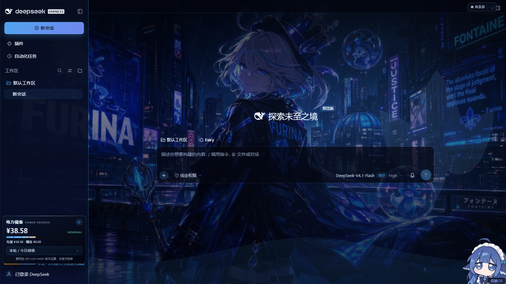
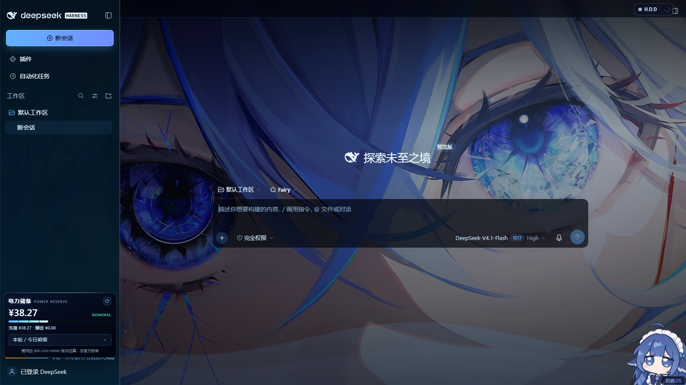
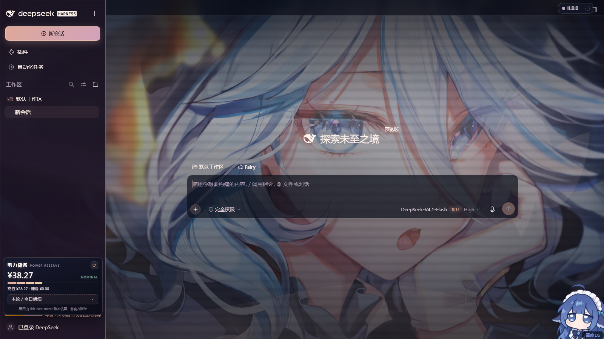
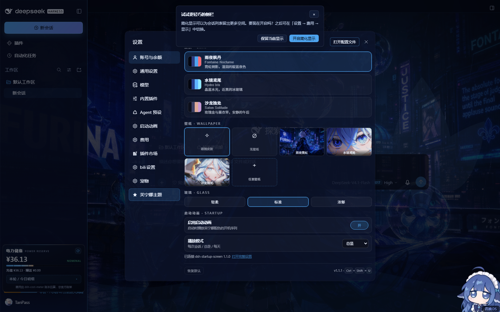
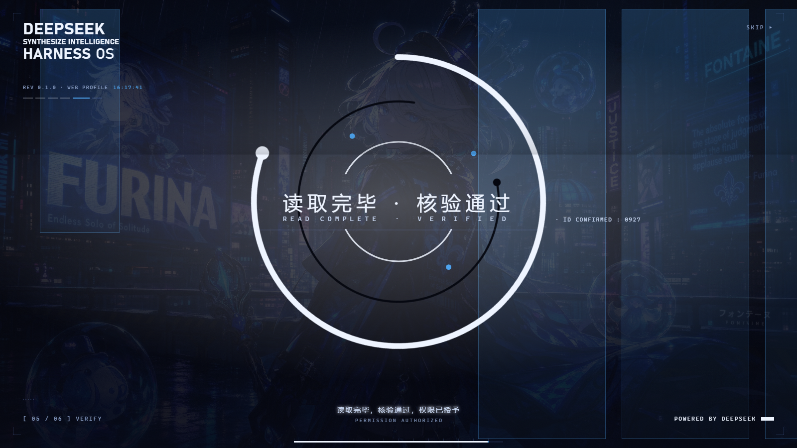
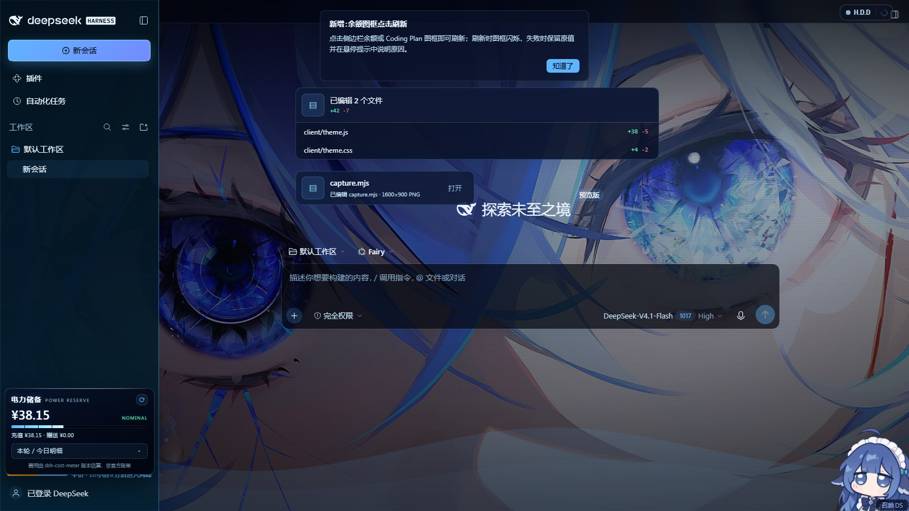
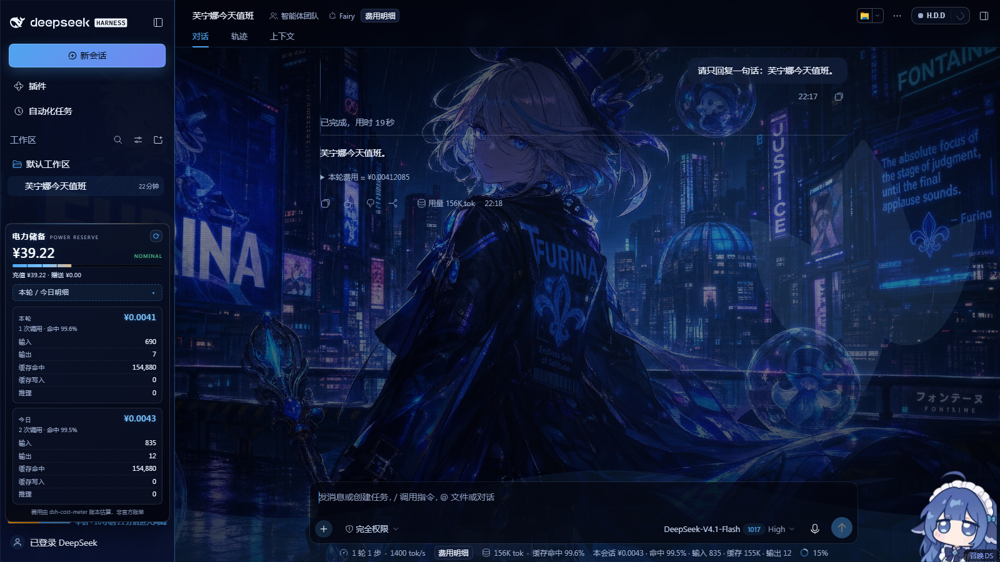
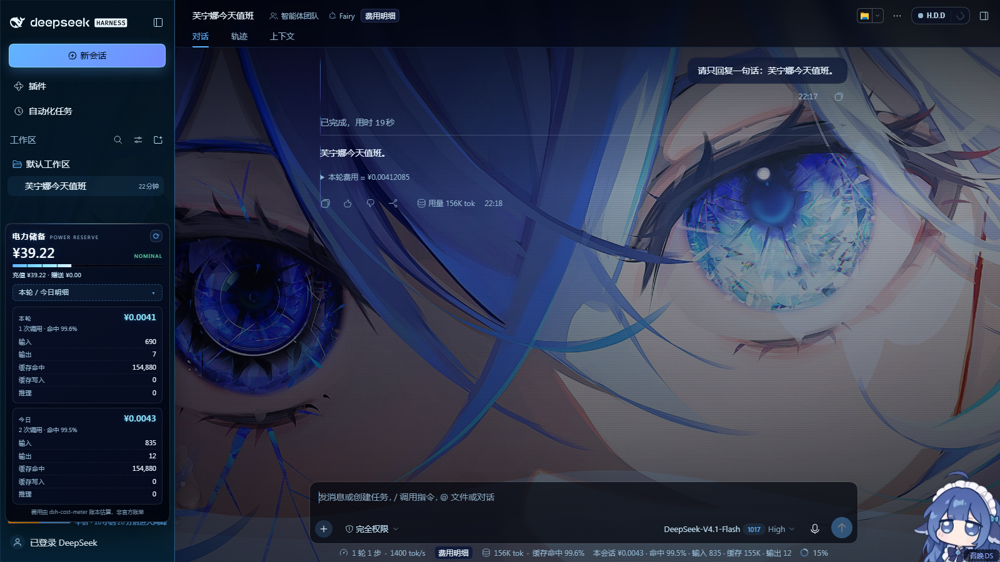
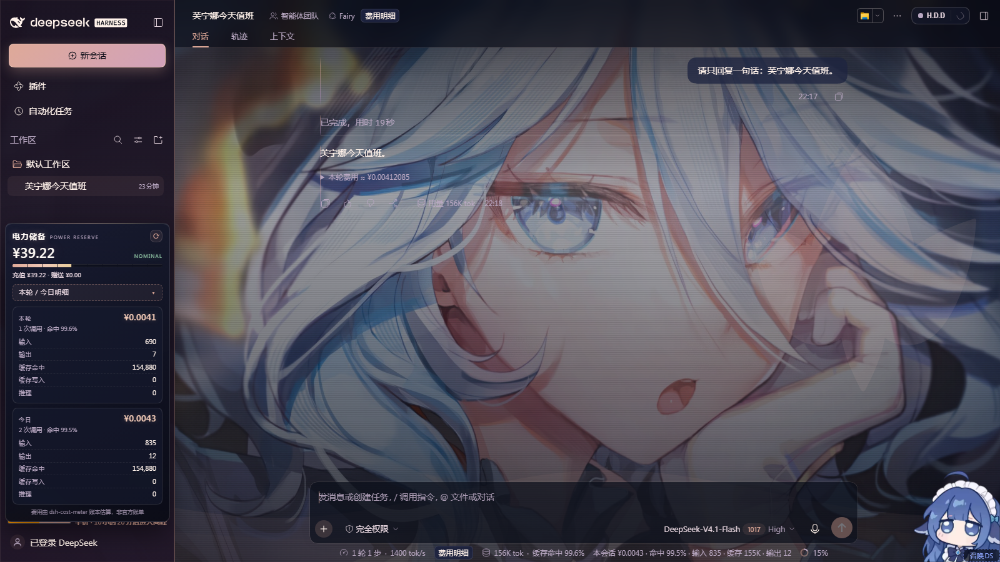

# furina-dsh-theme · 芙宁娜 / Fontaine theme for DeepSeek Harness

A complete web-theme plugin for the DeepSeek Harness Web GUI: three Furina / 芙宁娜
skins, a wallpaper layer you can switch on its own, translucent glass surfaces, a
芙宁娜主题 section inside DSH's own Settings dialog, a themed startup splash and
readable file cards — no rebuild, no patched markup, no `!important` arms race.

Repository: **https://github.com/TanPass/furina-dsh-theme** ·
Install: `dsh plugin --profile web add github:TanPass/furina-dsh-theme` ·
Issues: https://github.com/TanPass/furina-dsh-theme/issues

| Skin | Preview |
| --- | --- |
| `fontaine-nocturne` 雨夜枫丹 |  |
| `hydro-iris` 水镜鸢尾 |  |
| `salon-solitude` 沙龙独处 |  |

| Settings page | Startup splash | File & deliverable cards |
| --- | --- | --- |
|  |  |  |

All six images are real 1600×900 captures of throwaway DSH instances (isolated
`DSH_HOME`, ports 3083/3084) — see [Verification](#verification). The five round-1
captures under `docs/` (`screenshot-switcher-open.png` etc.) are kept as history:
they show the old floating switcher that round 2 replaced.

---

## What you get

* **Three skins**, each a full palette (background, surfaces, text hierarchy, four
  accents, semantic colours) mapped onto DSH's own `--dsh-*` design tokens, so every
  stock component — sidebar, composer, message bubbles, code blocks, menus — re-skins
  without touching application markup.

  | id | 中文 | feel | accent |
  | --- | --- | --- | --- |
  | `fontaine-nocturne` | 雨夜枫丹 | rain-slick neon, indigo night | `#4ea4ef` |
  | `hydro-iris` | 水镜鸢尾 | crystal water, near-black ice glass | `#5fb4ff` |
  | `salon-solitude` | 沙龙独处 | rose-gold afternoon, lavender | `#dea998` |

* **A wallpaper layer** behind the whole application. Three shipped wallpapers plus
  `跟随皮肤` (auto — each skin's own art) and `无壁纸` (painted ground). Wallpaper and
  skin are independent: pick the night-city art with the rose-gold palette if you
  want. Any image you drop into `$DSH_HOME/furina-wallpapers/` shows up in the
  switcher as an extra tile — free wallpaper switching is not limited to the shipped
  set.
* **Translucent glass UI** in three strengths — `轻柔` / `标准` / `浓郁` — applied to
  the sidebar, composer, popovers and the settings card itself.
* **A settings page inside DSH Settings** — a 芙宁娜主题 / Furina theme section in the
  app's own Preferences dialog (an extra nav row rendered in a Shadow DOM pane): skin
  cards with live swatches, a wallpaper tile grid — including `任意壁纸` to pick any
  local image — glass modes and reset. `Ctrl + Shift + U` still opens the same card
  from anywhere, and if the Settings dialog never appears a small emblem pill in the
  bottom-right corner remains as the fallback launcher.
* **A themed startup splash** — the installed `dsh-startup-screen` boot sequence is
  re-coloured per skin through its own `--dsu-*` custom properties, with the active
  wallpaper laid under the veil, so the first paint is Fontaine night instead of the
  stock white plate. The startup package is not modified.
* **Readable file & deliverable cards** — the "已编辑 …" changed-file card and the
  presented-file row are repainted from the skin palette instead of the stock white
  surface. See [File cards](#file-cards).
* **Per-skin sidebar** — left rail, workspace tree, account chip and footer take their
  tint from the active skin (`--fr-side-*` variables), with body text kept above the
  4.5:1 contrast target. See [Sidebar and text contrast](#sidebar-and-text-contrast).
* **Persistence** in `localStorage` under `furina-theme.settings.v1`. Settings survive
  reloads; deleting the key (or the plugin) returns the GUI to stock.
* **No residue when disabled**: every rule is scoped to `html[data-furina-skin…]`, the
  backdrop, settings pane, splash style and fallback launcher are plain DOM nodes the
  plugin removes on dispose, and the app never sees a monkey-patched React tree.

## Round 2 — settings page, startup splash, file cards, per-skin sidebar

Round 2 moved the controls out of the floating panel and fixed the two surfaces that
were still stock white: the first paint and the agent's file cards.

### Settings page

The app has no plugin slot for settings sections, so the theme mounts one the same way
the bundled plugins do:

* nav row appended to the settings dialog's own list — the dialog is
  `div[role="dialog"][data-shortcut-modal="settings"]`, the list is the `nav`'s
  `[class*="navList"]`; the row is a clone of a shipped `button.VOzbGW_navCell` with
  `data-furina-settings-nav`, labelled 芙宁娜主题. Third-party plugins (HDD / Fairy,
  bili, pets) add rows the same way, so the list is not React-private.
* content pane `#furina-settings-pane` (`[data-furina-settings-pane]`) is absolutely
  positioned over the dialog's options area; it holds a second Shadow DOM with the
  shared card markup (`controlsMarkup()` / `wireControls()` are shared with the
  fallback launcher, so the two can never drift apart).
* clicking another nav row restores the React options pane; a `MutationObserver`
  re-mounts the nav row and pane if React re-renders the dialog, and the boot flow
  keeps the old floating switcher code path dormant (`#furina-switcher` with
  `data-furina-fallback="1"`); it is only revealed when `[data-slot="settings.launcher"]`
  never appears, so the old UI remains an honest fallback rather than the primary
  surface.

Below 玻璃 the same pane carries the **启动动画 · Startup** block, so the companion
startup-animation plugin is operated from the same screen as the skin it is coloured
from: an enable switch, a 每次会话 / 总是 / 每天 play-mode select and a
`打开完整设置` link that jumps to the plugin's own section for its 30+ options. The
block talks to the plugin's own JSON endpoint (`GET`/`POST /dsh-startup/config`, patch
semantics owned by that plugin) and disables itself with an install hint when
`dsh-startup-screen` is not present — the theme never hard-depends on it.

### Startup splash

`client/theme.js` appends one `<style id="furina-startup-skin">` to `<head>`. The splash
root (`#dsh-startup-root`) already exists at the start of `<body>` by then, and the
overrides are pure custom-property declarations scoped by the active skin:

```
html[data-furina-skin='<skin>'] #dsh-startup-root {
  --dsu-bg / --dsu-bg-2 / --dsu-ink / --dsu-ink-soft / --dsu-muted
  --dsu-hair / --dsu-hair-soft / --dsu-box-bg / --dsu-box-ink / --dsu-sub-glow
  --dsu-accent / --dsu-glitch-a / --dsu-glitch-b   (the last four need !important
                                                    because splash.js writes them
                                                    inline on the same element)
}
```

plus paint-layer overrides for the hard-coded light parts of `splash.css`:
`.dsu-plate` (skin wallpaper + veil gradient), `.dsu-wm` (archive panels — the white
slabs), `.dsu-wash`, `.dsu-black`, `.dsu-flash`, `.dsu-bloom`. The black opening act
with the DeepSeek wordmark is intentionally left dark; everything after it is
Fontaine night. Proof is a capture of a **real boot** from an isolated instance that
keeps `dsh-startup-screen` in its bundle list (the shared verify instance removes it
because its GRANT ACCESS gate blocks automation) — `docs/screenshots/splash-boot.png`.

### File cards

The deliverables plugin only darkens its surfaces under `body[data-ds-dark-theme]`, and
this app runs its light token branch (`html[data-ds-theme-source="system"`,
`color-scheme: light`, no dark body attribute). Round 2 therefore:

* forces the dark branch from `theme.js`: `assertDarkMode()` sets
  `html.style.colorScheme="dark"`, `html[data-ds-theme-source="dark"]` and
  `body[data-ds-dark-theme]`, and a guarded `MutationObserver` re-asserts them if the
  app flips back;
* tints the plugin's own custom properties per skin, using selectors verified against
  the installed package (class names `hz8-rW_*`, `nyYjTG_*`):
  `[data-changed-files]` (`--changes-fill`, `--changes-hover`), `_header` / `_row` /
  `_path` / `_tile` / `_counts`, `[data-changes-hover-preview]` (diff hover card),
  `[data-presented-files-row]` (`--deliverable-fill`, `--deliverable-hover`),
  `[data-presented-file]`, `_fileIcon`, `_fileName`, `_description`.

Before: `#fafafa` fill with near-white text. After: `--fr-surface-2` fill, `--fr-text`
labels, accent-tinted icon tile, accent border — see `docs/screenshots/file-card.png`.

### Sidebar and text contrast

The left rail used to be a fixed navy gradient. Round 2 adds per-skin rail variables
in the palette blocks and paints the rail from them:

| variable | Fontaine Nocturne | Hydro Iris | Salon Solitude |
| --- | --- | --- | --- |
| `--fr-side-top` | `#070c1f` | `#03141f` | `#191122` |
| `--fr-side-bottom` | `#0b1438` | `#072a3f` | `#291b2f` |
| `--fr-side-line` | `rgba(78,164,239,.30)` | `rgba(143,232,255,.28)` | `rgba(222,169,152,.32)` |
| `--fr-side-active` | `rgba(78,164,239,.22)` | `rgba(95,180,255,.24)` | `rgba(199,155,214,.24)` |

```css
html[data-furina-skin] body [data-slot='sidebar'] > div {
  background: linear-gradient(180deg, color-mix(in srgb, var(--fr-side-top) var(--fr-g-soft), transparent),
                                      color-mix(in srgb, var(--fr-side-bottom) var(--fr-g-soft), transparent)),
              linear-gradient(180deg, color-mix(in srgb, var(--fr-accent) 7%, transparent), transparent 55%);
  border-right: 1px solid var(--fr-side-line);
}
```

Text colours were raised per skin and measured with the WCAG contrast formula against
every opaque token ground (worst case is usually `--fr-surface-2`, the lightest):

| skin | `--fr-text` (on `--fr-bg-deep` → `--fr-surface-2`) | `--fr-text-2` | `--fr-text-3` | `--fr-muted` |
| --- | --- | --- | --- | --- |
| Fontaine Nocturne | `#eef4ff` 18.44 → 15.06 | `#c3d2ec` 13.33 → 10.89 | `#9aabcc` 8.80 → 7.18 | `#7488ae` 5.70 → 4.65 |
| Hydro Iris | `#eaf7ff` 18.89 → 15.69 | `#c0dff2` 14.80 → 12.29 | `#93b6d0` 9.66 → 8.02 | `#6f92ad` 6.27 → 5.21 |
| Salon Solitude | `#fff2ea` 17.88 → 13.85 | `#e4d3dc` 13.69 → 10.60 | `#b9a8c2` 8.82 → 6.83 | `#94879f` 5.82 → 4.51 |

Every text step is above 4.5:1 in every skin and ground, including the muted/decorative
step. The glass panels on the main canvas keep their own translucent layers, so the
tint does not flatten them.

## Requirements

* DSH with the Web GUI (`dsh web`), profile `web`.
* Node 22+ (only for the plugin process; the browser half is plain ES5-era JS).
* **No other full-page theme enabled.** Themes that repaint the entire shell — notably
  `dsh-theme-endfield` / `dsh-endfield-theme` — override the same `--dsh-*` tokens and
  paint their own opaque layer over the app. They are not broken, but they will win:
  enable one theme at a time. See [Coexistence](#coexistence-with-other-themes).

## Install

The plugin is a normal DSH cordis plugin, installed into a profile with `dsh plugin`:

```powershell
# canonical install — straight from GitHub
dsh plugin --profile web add https://github.com/TanPass/furina-dsh-theme
# same package, short GitHub spec
dsh plugin --profile web add github:TanPass/furina-dsh-theme

# or, without `dsh` on PATH, through the DSH checkout's CLI entrypoint
node "<dsh-checkout>\lib\bin.js" plugin --profile web add https://github.com/TanPass/furina-dsh-theme
```

A published version can be pinned the same way, e.g.
`dsh plugin --profile web add furina-dsh-theme@1.1.0`.

**Local development** — install the working tree as a link, so edits are live after a
page refresh:

```powershell
dsh plugin --profile web add file:"<path-to-this-checkout>"
```

The profile's `package.json` should then contain the artifact spec under
`dependencies`, with the package in `dsh.profile.bundles`:

```jsonc
{
  "dependencies": { "furina-dsh-theme": "github:TanPass/furina-dsh-theme" },
  "dsh": { "profile": { "bundles": [ /* …, */ "furina-dsh-theme" ] } }
}
```

Restart the DSH server once if the profile bundle list changed; after that, refresh
the page. `cordis.patch.yml` ships with the package and inserts its own `furina-theme`
plugin row; `dsh --dump-config` shows the resolved row (see Verification).

To uninstall: `dsh plugin --profile web remove furina-dsh-theme` (or remove the bundle
entry and the dependency), then restart the server. The browser half also disposes
cleanly if the plugin row is removed while a page is open.

## Coexistence with other themes

Two full-page themes cannot both own the surface. The measured behaviour with
`dsh-theme-endfield` + `dsh-endfield-theme` also installed:

* their rules win on `--dsh-*` tokens and paint an opaque page layer, so this theme's
  wallpaper and palette are mounted but invisible;
* nothing errors — the plugin simply renders underneath.

So enable exactly one theme. If the Furina theme does not appear:

1. Open the profile `package.json` (`C:\Users\<you>\.dsh\profiles\web\package.json`).
2. Remove `dsh-theme-endfield` and `dsh-endfield-theme` from `dsh.profile.bundles`.
3. Also remove the `- id: theme-endfield` row from `cordis.patch.yml` if present.
4. Restart the DSH web server and reload the page.

(Removing other themes touches a live profile — back it up first. In the isolated
instance used for verification, the same two bundles were removed and the theme
painted immediately; with them present the theme mounted but stayed hidden.)

## Using it

* **Settings page** — open DSH Settings (account chip → 设置, or `Ctrl + Alt + ,`), then
  pick 芙宁娜主题: skin cards (accent swatches + one-line description), wallpaper tiles
  (`跟随皮肤` / `无壁纸` / three art tiles / `任意壁纸`), glass strength and reset.
* **Keyboard** — `Ctrl + Shift + U` opens/closes the same card on top of the app,
  `Esc` closes it.
* **Fallback launcher** — if the page never renders the Settings launcher
  (`[data-slot="settings.launcher"]`), the Furina emblem pill stays in the
  bottom-right corner and opens the same card as a modal.
* **Custom wallpapers** — two ways: `任意壁纸` picks any local image (downscaled to
  max 1920 px and stored as a data URL in the settings key), or drop
  `.jpg` / `.png` / `.webp` / `.avif` files into
  `%USERPROFILE%\.dsh\furina-wallpapers\` (or `$DSH_HOME/furina-wallpapers/`) and
  reload; the browser half asks the host for that list via
  `GET /furina-theme/wallpapers`.
* **Scripting** — the browser half exposes a small API for console use and tests:

  ```js
  window.__furinaTheme.skins        // ['fontaine-nocturne', 'hydro-iris', 'salon-solitude']
  window.__furinaTheme.wallpapers   // ['city-noir', 'hydro-iris', 'salon-solitude']  (built-ins)
  window.__furinaTheme.state        // { skin, wallpaper, glass }
  window.__furinaTheme.mounted      // { sheet, backdrop, switcher, skin }
  window.__furinaTheme.setSkin('hydro-iris')
  window.__furinaTheme.setWallpaper('salon-solitude')  // 'auto' | 'none' | id | 'user:<file>'
  window.__furinaTheme.setGlass('rich')                // 'soft' | 'standard' | 'rich'
  window.__furinaTheme.openPanel(true)
  window.__furinaTheme.reset()      // defaults: fontaine-nocturne / auto / standard
  window.__furinaTheme.remount()    // re-inject after an SPA hard reset
  ```

## How it works

Two halves, one package.

**Host half — `lib/index.js`** (Node, runs inside the DSH server):

* registers one prefix route `/furina-theme` and serves the browser half:
  `theme.css`, `theme.js`, `assets/emblem.svg`, `assets/wallpapers/*.jpg`,
  `assets/thumbs/*.jpg`;
* path traversal is resolved and rejected (`resolveRelative`), requests are restricted
  to same-origin via `Sec-Fetch-Site` / `Origin`, and unknown files 404 instead of
  taking the route down;
* `GET /furina-theme/wallpapers` lists `$DSH_HOME/furina-wallpapers` (images only)
  and `GET /furina-theme/user-wallpaper/<name>` serves them;
* injects two tiny rows into `index.html`: a critical `html,body{background-color:…}`
  style (prevents a stock-white flash before the theme CSS loads) and the theme
  `<script>` tag; a companion row sets `data-furina-boot` on `<html>` so the first
  stylesheet can fade its decoration in. `theme.js` clears that attribute once the
  backdrop is mounted, with a 4-second timer as the fallback.

**Browser half — `client/theme.js` + `client/theme.css`** (no framework, no build):

* `theme.css` defines a semantic `--fr-*` palette per skin and maps it onto the app's
  `--dsh-*` tokens plus targeted surface rules scoped to `html[data-furina-skin…]`;
* `theme.js` owns the wallpapers (a fixed backdrop layer at `z-index:-1` so nothing
  intercepts input), the glass strength, the settings-page integration, the themed
  startup splash style, the forced dark token branch, keyboard shortcuts and
  `localStorage` persistence;
* a `MutationObserver` reconciles the injected nodes if the SPA (re)renders and drops
  them — backdrop, fallback launcher, settings nav row/pane — and re-asserts the dark
  theme attributes;
* the boot attribute `data-furina-boot` is removed on first paint so a failed load
  never leaves the page with a blank ground.

Settings shape (versioned, tolerant of unknown values):

```json
{ "skin": "fontaine-nocturne", "wallpaper": "auto", "glass": "standard", "customSrc": null }
```

`customSrc` is the optional data URL written by `任意壁纸` (`wallpaper: "custom"`); it is
only honoured when it starts with `data:image/`, and the key is dropped by 恢复默认.

## Verification

Two layers, both runnable from the repository.

### 1. Unit tests

```powershell
npm test
# or, if npm's PowerShell shim is blocked by execution policy on this machine:
node --test test/host.test.mjs test/client.test.mjs
```

`node --test test/*.test.mjs` (or plain `node --test`) runs 36 tests across
`test/host.test.mjs` (route resolution and traversal rejection, content types,
same-origin gate, wallpaper listing/serving, injection rows, dispose),
`test/client.test.mjs` (skin/wallpaper tables, settings read/write tolerance,
wallpaper resolution, markup escaping, keyboard map) and `test/billing.test.mjs`
(billing document: balance merge incl. granted wallets, day buckets, endpoint shape).

### 2. Live instance

`tools/verify.mjs` boots a private Chromium (Edge) page against a running DSH web
server, drives the theme through `window.__furinaTheme`, asserts 14 checks and writes
the screenshots above.

The captures were taken against an isolated `DSH_HOME` on a spare port (the live GUI
was never touched). Reproduce them anywhere by pointing the same script at your own
instance:

```powershell
$verifyHome = "<scratch-dir>\.dsh"        # throwaway home: a copy of profiles/web, with the
$env:DSH_HOME = $verifyHome               #   competitor full-page themes removed
node "<dsh-checkout>\lib\bin.js" web --port 3081 --no-open --host 127.0.0.1
#   → prints http://127.0.0.1:3081/?token=…   (single-use: every navigation spends it,
#     so a re-run needs a fresh token, i.e. a server restart)
node tools/verify.mjs --url "<printed url>" --outdir "<repo>\docs"
```

(`tools/verify.mjs --url <url>` is the only required argument; `--outdir` defaults to
`docs/`. It needs Edge or Chrome and no extra npm dependencies — it speaks CDP over
the standard WebSocket in Node 22+.)

Result — `docs/verify-report.json`:

```
PASS  browser half mounted (sheet + backdrop + switcher)
PASS  skin attribute present
PASS  theme tokens reach the app
PASS  wallpaper layer is on
PASS  backdrop sits behind the app
PASS  switcher is a shadow-root panel with every choice
PASS  body ground is transparent (wallpaper shows through)
PASS  skin fontaine-nocturne applied in place
PASS  skin hydro-iris applied in place
PASS  skin salon-solitude applied in place
PASS  switcher panel opens
PASS  wallpaper changes independently of the skin
PASS  no-wallpaper mode keeps a painted ground
PASS  no attributable page exceptions from the app
{"ok":true,"checks":14,"failed":0}
```

The `cordis.patch.yml` insert was also checked against the verify profile with
`--dump-config`; the resolved config shows the row the package's own patch adds:

```
# == furina-dsh-theme
- id: furina-dsh-theme
  name: furina-dsh-theme
```

(`--dump-config` also prints "patch: entry … not found" warnings for rows in the
*copied* verify profile that referenced bundles removed there — wallpaper-engine,
ui-theme-firefly, ui-skin-maid-atelier, theme-endfield. Those are leftovers of the
copy, not rows this package adds.)

### Limitations of the evidence

* Screenshots are 1600×900 headless-Chromium captures of throwaway profiles; they
  prove mount + paint + switching, not every component state (dialogs, streaming
  transcripts) in every skin.
* `splash-boot.png` is a **real boot** capture (isolated instance with the installed
  `dsh-startup-screen` kept in the bundle list, splash forced to `mode: always`,
  captured at ~6.6 s). The port-3083/3084 instances are throwaway: the live GUI and
  the installed theme copy under `~/.dsh/profiles/web/node_modules/furina-dsh-theme`
  were never touched.
* `file-card.png` renders the changed-file and presented-file cards in a live page
  using the installed deliverables plugin's own class names (`hz8-rW_*`,
  `nyYjTG_*`, loaded from its `data-plugin-css` modules) and data attributes; there
  is no agent transcript in a throwaway profile, so the card content is seeded rather
  than produced by a real tool call.
* The settings page is injected into the app's dialog (a cloned nav row + an
  absolutely positioned Shadow DOM pane). It follows the app's DOM contract, not a
  public plugin slot, so a future Settings redesign may need the selectors refreshed;
  the fallback launcher keeps the controls reachable in that case.
* The isolated instance runs with the two full-page competitor themes removed — that
  is the supported configuration, not a hidden workaround (see
  [Coexistence](#coexistence-with-other-themes)).
* The theme is CSS-first: it re-skins DSH's design tokens and a bounded set of
  surfaces. It does not restyle third-party plugin UI that hard-codes its own colours.

## Billing panel (电力储备 / POWER RESERVE)

The theme ships a compact sidebar panel, appended above the account row:

* **Reserve gauge** — the account balance as the *full* spendable reserve:
  topped-up credit **plus** granted/bonus wallets (the reference implementation
  this panel was ported from read `value` only and dropped `bonusWallets`, so
  granted credit never reached the gauge). Caption switches between `NOMINAL`,
  `OUTPUT LOW`, `DEPLETED` and `NO SIGNAL`.
* **Today** — calls, cache-hit rate, estimated cost and the five token types of
  the current local day: input, output, cache read, cache write, reasoning.
* **本轮 (current turn)** — the same breakdown for the newest turn of the
  selected conversation, read from that session's log.
* **Collapsible detail** ("本轮 / 今日明细"), a manual refresh button and a 60 s
  poll. Costs are printed in CNY; the ledger stores USD, so the panel converts
  with `costMeter`'s configured `exchangeRate` (default 7.2) and always shows the
  estimate marker.

The panel is honest about missing data: `available:false` plus a reason is
rendered as `—` and a short Chinese explanation, never as `0`. A real `0` (no
calls today) stays `0`. The endpoint answers `503 {"ok":false,
"error":"billing-unavailable"}` when the host half is not installed, and the
panel then removes itself instead of showing an empty gauge.

### Screenshots

1600×900, expanded table, real `dsh-cost-meter` data (本轮 ¥0.0041 / 今日
¥0.0043 at capture time):

| skin | panel |
| --- | --- |
| Fontaine Nocturne |  |
| Hydro Iris |  |
| Salon Solitude |  |

Legibility was checked in all three skins: the figure uses `--fr-bill-text`
(near-white) and the token labels `--fr-bill-2` (Fontaine `rgb(154,171,204)`,
Hydro `rgb(147,182,208)`, Salon `rgb(185,168,194)`) over the translucent panel
surface, so every row stays above the 4.5:1 body-text contrast target. The
card's bottom edge is measured against the account-row footer, so the expanded
table clears the user chip at 900 px height and the detail area scrolls if the
viewport is shorter.

### Data source

Everything comes from the injected `dsh-cost-meter` service; this package does
not read credentials and does not call the DeepSeek API itself:

| field | source |
| --- | --- |
| balance (incl. bonus) | `costMeter.getState().balance` (already reconciles bonus wallets) |
| today tokens / calls / cost | `costMeter.getState().today` |
| current turn | `costMeter.getSessionBilling({sessionId})`, newest non-empty turn |
| fallback balance | `deepseekAccount.getBalance()` — used only when cost-meter is absent, merging `value` + `bonusWallets` |

Because the service must be mounted, `cordis.patch.yml` inserts a second row:

```yaml
# == furina-dsh-theme
- id: furina-dsh-theme
  name: furina-dsh-theme
- id: furina-cost-meter
  name: dsh-cost-meter
```

and `dsh-cost-meter` is a runtime dependency (`>=1.8.24`).

### Endpoint

```
GET /furina-theme/api/billing?session=session-<uuid>[&fresh=1]
```

Same-origin only (the host route rejects cross-origin requests). Shape:

```json
{
  "ok": true,
  "generatedAt": "2026-10-22T14:00:00.000Z",
  "currency": "CNY",
  "exchangeRate": 7.2,
  "balance": {
    "available": true, "reason": null, "currency": "CNY",
    "total": 42.24, "toppedUp": 17.22, "granted": 25.02,
    "updatedAt": "2026-10-22T13:59:00.000Z", "source": "cost-meter"
  },
  "today": {
    "available": true, "reason": null, "date": "2026-10-22",
    "calls": 18, "tokens": { "input": 12000, "output": 3400, "cacheRead": 88000, "cacheWrite": 1200, "reasoning": 900 },
    "cacheHitRate": 0.868, "cost": { "usd": 0.0123, "cny": 0.08856 },
    "apiCost": { "usd": 0.0123, "cny": 0.08856 }, "includesPlan": false
  },
  "turn": { "available": true, "reason": null, "sessionId": "session-…", "turn": 7, "calls": 3, "tokens": { "…": 0 }, "cacheHitRate": 0.8, "cost": { "usd": 0.001, "cny": 0.0072 }, "apiCost": { "usd": 0.001, "cny": 0.0072 }, "includesPlan": false },
  "meta": { "now": 1761132000000, "dayKey": "2026-10-22", "monthKey": "2026-10", "timezone": "Asia/Shanghai", "timezoneOffsetMinutes": 480, "host": "dsh" },
  "costMeter": { "available": true, "reason": null }
}
```

`turn` is returned only when a valid `session` is supplied; without one it is
`{"available":false,"reason":"no-session"}`. Values are illustrative of the shape
only — the live figure comes from the ledger.

### Dependencies and privacy

* one new runtime dependency: `dsh-cost-meter` (the service that owns the ledger);
* the panel reuses the theme's palette variables (`--fr-*`), so it stays legible
  in all three skins;
* no credentials are read, logged or sent anywhere by this plugin — the panel
  only asks the local host process.

## Files

```
package.json            dsh.bundle.patch → ./cordis.patch.yml, files: lib, client
cordis.patch.yml        inserts the `furina-theme` plugin row + the `dsh-cost-meter` service row
lib/index.js            host half: routes, injection rows, file serving, disposal
lib/billing.js          billing document: cost-meter adapter, balance merge (incl. bonus wallets)
client/theme.css        palettes + token mapping + glass/surface + sidebar/deliverable rules
client/theme.js         backdrop, settings page, themed splash, dark branch, persistence, keyboard
client/billing.css      "电力储备" card styling from the skin palette variables
client/billing.js       self-mounting reserve gauge + 本轮/今日 token & cost table
client/assets/          emblem.svg, 3 wallpapers, 3 thumbnails
test/                   node:test suites (host, client, billing)
tools/verify.mjs        live-instance CDP verification + screenshots
docs/                   round-1 screenshots + verify-report.json
docs/screenshots/       round-2 proof shots (three skins, settings page, splash boot, file cards)
companion/              reference/companion plugins, source-identical, for reading and credit
  dsh-startup-screen/     the startup animation this theme tints (MIT, © 沈宏宏)
CREDITS.md              art sources, companion plugin authors and licence texts
LICENSE                 MIT License (code only)
NOTICE.md               asset provenance and character/IP notice
```

## Credits

Fan-art wallpapers (full sources, licence notes and re-encode details in
[CREDITS.md](CREDITS.md)):

| File | Creator / credit | Source |
| --- | --- | --- |
| `furina-01-city-noir.jpg` | **rotvirtue** | [Wallpaper Abyss #1409444](https://wall.alphacoders.com/big.php?i=1409444) |
| `furina-02-hydro-iris.jpg` | **58\_(opal_00_58)** | [Danbooru 5837276](https://danbooru.donmai.us/posts/5837276) |
| `furina-03-salon-solitude.jpg` | artist not named on the page | [Wallpaper Abyss #1353872](https://wall.alphacoders.com/big.php?i=1353872) |

Companion plugin: [`dsh-startup-screen`](https://github.com/6shenhonghong9/dsh-startup-screen)
1.1.0 by **沈宏宏** (MIT) — vendored unmodified in
[`companion/dsh-startup-screen/`](companion/dsh-startup-screen/) with its original
licence; the theme re-colours its splash per skin and exposes its enable/mode controls
in the settings page. `dsh-cost-meter` 1.8.24 by **Han-1413141** (MIT) powers the
电力储备 panel and is declared as an npm dependency, not copied.

## License

The code in this repository is released under the **MIT License** — see
[LICENSE](LICENSE).

The character artwork is **not** MIT: the wallpapers, thumbnails and emblem are fan art
of Furina (《原神》 / Genshin Impact, © HoYoverse), included for personal, non-commercial
theming only. See [NOTICE.md](NOTICE.md) before redistributing or publishing this
repository — or replace the images in `client/assets/` with art you may redistribute
(the theme works with any images).

The vendored startup plugin in `companion/dsh-startup-screen/` keeps its own MIT
notice and copyright (© 沈宏宏); see that folder's `LICENSE`.
